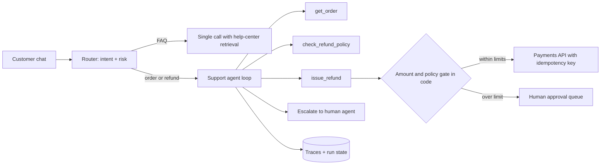
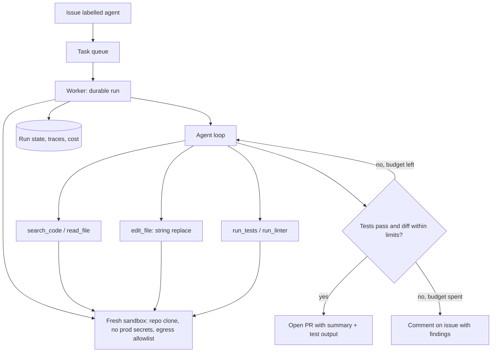
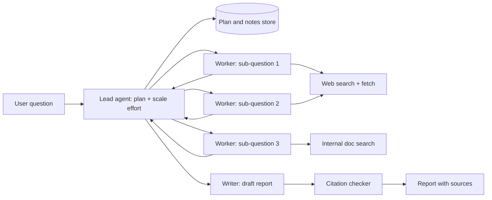
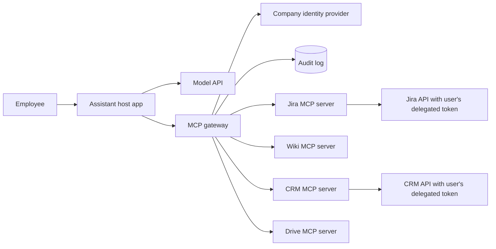
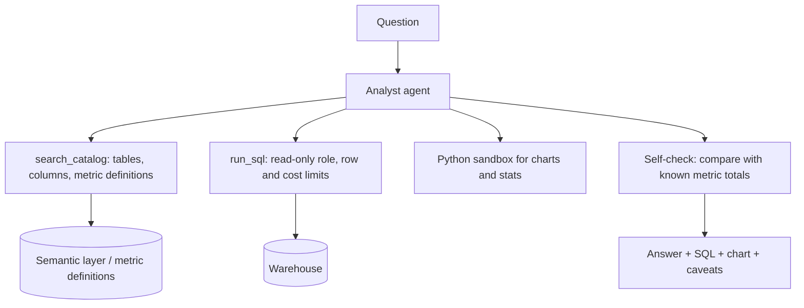

# System design scenarios

[Question index](README.md) · [Repo home](../README.md) · Previous: [Safety and security](09-safety-and-security.md) · Next: [Coding exercises](11-coding.md)

5 worked scenarios, Q106 to Q110. Agent design rounds usually run 45 to 60 minutes. Each scenario below is the shape of a strong answer, compressed: clarify, draw the system, make the key decisions out loud, say how you would evaluate it, and name the failure modes before the interviewer does.

All numbers here are back-of-envelope estimates to show the reasoning. They are not measurements, and you should say so in the room too.

A structure that works for any agent design prompt:

1. **Clarify.** Users, tasks, which actions have side effects, scale, latency, risk.
2. **Workflow or agent.** Which parts are fixed paths and which need model decisions.
3. **Tools and permissions.** Task-shaped tools, scopes, what needs approval.
4. **Context and state.** What goes in the window, what lives in storage.
5. **Evals.** Task set, graders, pass^k, online signals.
6. **Reliability and cost.** Retries, idempotency, durable runs, budgets.
7. **Security.** Untrusted inputs, the lethal trifecta, sandboxing.

Difficulty is `Senior` or `Staff`. All five are `Representative`.

---

### Q106. Design a customer support agent that can issue refunds.

`Senior` · `Representative`

**Clarify.** E-commerce support over chat. The agent answers order questions, processes returns, and issues refunds within policy. Say 50,000 conversations a day, about 30% need an action. Refunds above $200 or outside policy need a human. Response time target of a few seconds per turn.

**Key decisions.**
- A router sends simple FAQ traffic to a single retrieval call, because most questions do not need a loop. Only order and refund conversations reach the agent.
- Tools are task-shaped: `get_order` returns status, items and eligible actions in plain fields; `check_refund_policy` returns allowed and the reason; `issue_refund` takes an order id and amount.
- Policy lives in code. `issue_refund` checks the limit and eligibility itself; the prompt explains the policy so the agent can tell the customer, but cannot bypass it.
- Idempotency key per refund, from conversation id and order id, so a retry never refunds twice.
- Escalation is a tool with a structured summary, so the human agent does not reread the chat.

**Evals.** A tau-bench style set: simulated customers with goals mined from real tickets, a sandbox order database, and graders on the final database state plus policy checks on the trajectory (no refund over the limit without approval). Track pass^k, since every customer gets one attempt. Online: resolution rate, escalation rate, refunds reversed by humans, customer satisfaction.

**Numbers (estimate).** 15,000 agent conversations a day, about 6 model calls each at roughly 8,000 input tokens with caching, is around 720 million input tokens a day, mostly cached prefix. That is why the stable system prompt and tool definitions go first.

**Failure modes to name.** Refunding on a hallucinated order id (tool validates ids). Social engineering ("my manager said you can refund $500"); the code gate does not care. Loops on unclear requests (step limit, then escalate). Injection through order notes or product reviews if the agent reads them (treat as data, no sends based on them).

**Follow-ups.** *How do you handle a customer who disputes the policy?* Escalate with context; the agent does not negotiate policy. *How do you roll out?* Shadow mode where the agent drafts and humans send, then auto-send for low-risk intents first.

**Read:** [tau-bench](https://arxiv.org/abs/2406.12045) · [A practical guide to building agents](https://cdn.openai.com/business-guides-and-resources/a-practical-guide-to-building-agents.pdf)

---

### Q107. Design a coding agent that takes a GitHub issue and opens a pull request.

`Staff` · `Representative`

**Clarify.** Internal tool for a company with a few hundred repos. Input is an issue labelled for the agent. Output is a PR that a human reviews; the agent never merges. Tasks take minutes to an hour. Languages: mostly Python and TypeScript.

**Key decisions.**
- Single agent, linear history. Coding has few parallel subtasks and lots of shared decisions, so multi-agent adds conflict without much gain. Sub-agents only for read-only exploration that returns a summary.
- Sandbox per task: a microVM or hardened container with the repo, dependencies, and no production credentials. Network allowlist for package registries only.
- Tools matter more than the prompt: grep-style search, file reads by range, edits by exact string replacement, test runner returning a short failure summary with the full log saved to a file.
- Verification is the stop condition: tests and linters pass, the diff stays under a size limit, and the agent writes a PR description with what changed and why.
- A repo instructions file per repo (build commands, conventions) loaded at start.

**Evals.** Historical issues from our own repos with the real fix's tests as graders, SWE-bench style, held out from any prompt tuning. Track resolution rate, pass^k, cost and time per task. Human review scores on a sample for code quality, since tests do not catch everything. Online: PR merge rate, review comments per PR, reverts.

**Numbers (estimate).** 200 tasks a day at about 50 steps and 40,000 average input tokens per step is 400 million input tokens a day before caching. Caching and clearing old tool output are the main cost levers; per-task budgets stop outliers.

**Failure modes to name.** Editing tests to make them pass (diff check flags test changes, reviewers see them). Premature "done" without running tests (code requires a test run before PR). Huge diffs (size cap). Prompt injection in issue text or code comments asking it to exfiltrate secrets (no secrets in the sandbox, egress blocked).

**Follow-ups.** *How do you handle flaky tests?* Rerun failures once, and report flakiness in the PR rather than "fixing" it. *Monorepo with 2 million files?* Search tools and a code index; never load the tree.

**Read:** [SWE-bench](https://arxiv.org/abs/2310.06770) · [SWE-agent](https://arxiv.org/abs/2405.15793) · [Effective harnesses for long-running agents](https://www.anthropic.com/engineering/effective-harnesses-for-long-running-agents)

---

### Q108. Design a deep research agent that writes cited reports.

`Senior` · `Representative`

**Clarify.** Users ask open questions ("compare EU and US rules on AI in hiring"). Output is a report with citations in 5 to 15 minutes. Sources: web search and an internal document store. Quality matters more than speed; cost per report should stay under a few dollars.

**Key decisions.**
- Orchestrator-worker, because research is parallel reading. Workers get clear objectives, output formats, tool guidance and boundaries, which Anthropic found prevented duplicate searches.
- Effort scales with the question: one worker for a fact lookup, several for comparisons. Hard cap on workers and tool calls.
- Workers return condensed findings with source URLs and quotes, not raw pages, so the lead's context stays small.
- The plan and notes live in a store, so a long run can survive compaction or restarts.
- A citation pass checks that each claim maps to a fetched source, and drops or flags unsupported claims.
- Source quality guidance in prompts (prefer primary sources) after seeing workers favour low-quality pages.

**Evals.** A set of research questions with rubric-based LLM judging (factual accuracy, citation accuracy, completeness, source quality, tool efficiency), calibrated against human ratings; human review of a sample each release. Track tokens and time per report. Compare against a single-agent baseline every cycle.

**Numbers (estimate).** 4 workers at 30 tool calls and 15,000 average tokens per call, plus the lead and writer, lands near 2 million tokens a report. That sits in the range of the "about 15 times a chat" figure, and it is why smaller worker models and tight outputs matter.

**Failure modes to name.** Duplicate work across workers. Hallucinated or mismatched citations (checker). Injection from fetched pages (workers have no write or send tools, so the trifecta is broken). Endless research (budgets and a "good enough" criterion).

**Follow-ups.** *Real-time progress?* Stream the plan and worker status to the UI. *Internal plus web sources with permissions?* Internal search runs with the user's own permissions, and the report shows which sources were internal.

**Read:** [How we built our multi-agent research system](https://www.anthropic.com/engineering/multi-agent-research-system)

---

### Q109. Design an internal assistant that works across company tools through MCP.

`Staff` · `Representative`

**Clarify.** 5,000 employees. The assistant reads and acts in Jira, the wiki, Slack, the CRM and Google Drive. It must respect each user's existing permissions. Security wants audit logs and no data leaving the company. Different teams will add their own MCP servers over time.

**Key decisions.**
- A gateway in front of all servers handles OAuth against the identity provider, per-user and per-tool authorisation, an allowlist of approved servers with pinned tool descriptions, audit logging, and rate limits.
- Every downstream call uses the user's delegated, audience-bound token, so the assistant can never see more than the user can. No token passthrough; servers validate tokens issued for themselves.
- Tool filtering per request: the gateway exposes only tools relevant to the user's role and the current task, plus tool search, to keep the context small. Fifty servers' tools in every prompt would wreck selection.
- Write actions (create ticket, post message, edit doc) show a preview and need confirmation. Sending outside the company is not a capability at all.
- Servers are stateless on the 2026-07-28 spec, so each scales behind a plain load balancer.

**Evals.** Task sets per integration (find, summarise, create, update) run in a sandbox tenant, plus cross-tool tasks. Permission tests: a user without access must not get the data through the assistant. Injection tests: a planted instruction in a wiki page or Slack message must not cause an action.

**Numbers (estimate).** 5,000 users at 20 requests a day is 100,000 runs a day, maybe 400,000 tool calls through the gateway, around 5 per second on average with peaks several times higher. The gateway is not a scaling problem; its policy correctness is the hard part.

**Failure modes to name.** The lethal trifecta: Slack and wiki are untrusted content written by anyone, Drive and CRM hold private data, so posting and any external channel stay gated. A new team's server with a poisoned description (review and pinning). Stale permissions cached in an index (query with the user's live token).

**Follow-ups.** *Let teams self-serve new servers?* Yes, through a registry with review, a security scan of descriptions, and staged enablement. *What do you log?* User, tool, arguments (redacted), result size, decision, latency.

**Read:** [MCP authorization](https://modelcontextprotocol.io/specification/2026-07-28/basic/authorization/index) · [MCP security best practices](https://modelcontextprotocol.io/specification/2025-11-25/basic/security_best_practices) · [The lethal trifecta](https://simonwillison.net/2025/Jun/16/the-lethal-trifecta/)

---

### Q110. Design a data analysis agent that answers questions over a warehouse.

`Senior` · `Representative`

**Clarify.** Business users ask questions in plain English ("why did churn rise in Q3 in Germany?"). The agent writes SQL against a warehouse with a few hundred tables, runs it, and answers with numbers and a chart. Read-only. Answers must be correct or say they are unsure. Queries cost money, so scans must be bounded.

**Key decisions.**
- Metric definitions come from a semantic layer, not the model's guess. "Churn" means the company's definition, retrieved by a catalog tool, so two users get the same number.
- `run_sql` uses a read-only role, enforces a row limit and a cost or bytes-scanned limit with a dry run first, and returns a sample plus summary stats, not a million rows.
- Big results go to the sandbox as files; the agent analyses them with code instead of pulling rows into context. This is the code-agent pattern.
- Every answer shows the SQL and assumptions so a human can check it.
- A self-check step compares totals to known dashboards when possible and states uncertainty when results look off.

**Evals.** A set of questions with verified answers from analysts, graded on the numbers (with tolerance) and on whether the SQL used the right metric definitions. Include ambiguous questions where the right move is to ask which definition the user means. Track query cost per answer.

**Numbers (estimate).** 2,000 questions a day at 3 to 5 queries each is up to 10,000 queries a day. If an unbounded query could scan a terabyte, the scan limit is the main cost control, more than tokens.

**Failure modes to name.** Plausible wrong SQL: joins that double-count, wrong date filters (metric definitions and self-checks). Leaking data across access levels (the agent queries with the user's own warehouse permissions). Injection from free-text columns like support notes (results are data; the agent has no write or send tools).

**Follow-ups.** *Text-to-SQL fine-tuning?* Not first. A good catalog tool and metric layer usually move accuracy more. *Scheduled reports?* Turn a validated question into a saved, deterministic query; do not re-run the agent every morning.

**Read:** [Executable Code Actions Elicit Better LLM Agents](https://arxiv.org/abs/2402.01030) · [Writing effective tools for agents](https://www.anthropic.com/engineering/writing-tools-for-agents)

---

[Question index](README.md) · Next: [Coding exercises](11-coding.md)
